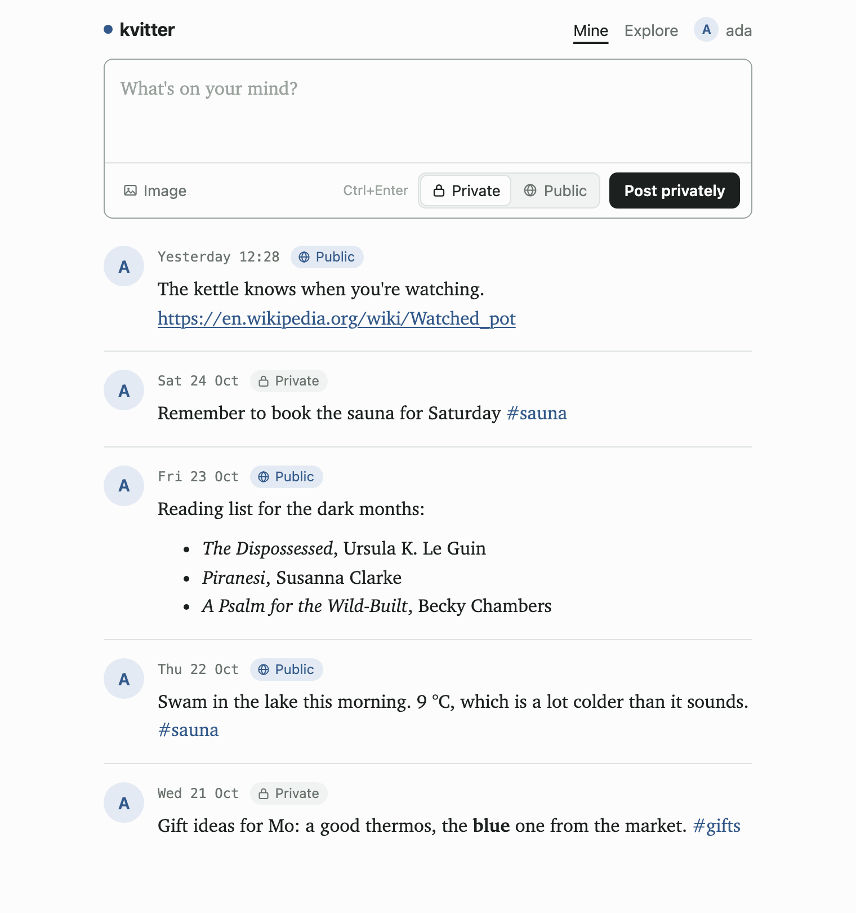

# Kvitter

A small place for short posts. Private by default, public when you choose, with public posts on a domain of their own.



- **Private first.** New posts are private. Making one public puts it on `/explore`, in the RSS feed and the sitemap, and on your public domain for anyone to read.
- **Markdown, kept as typed.** The composer shows the markdown you write, styled in place. `#tags` autocomplete, and images upload by button, paste or drop.
- **Nothing leaks.** Private posts don't show up in tag counts, feeds, autocomplete or link previews. A private post and a missing one look the same. Images follow the post they're in, and their location data is stripped on upload.
- **Light.** One Rust binary with SQLite. Every page is server-rendered HTML and works without JavaScript, except image upload.

Kvitter is a [Realm](https://yourrealm.eu) micro app: Realm signs you in and serves the public domain.

## Install on Realm

Install it from [`realm.ts`](realm.ts). It runs `ghcr.io/benjick/kvitter:latest`, which CI publishes on every push to `main`.

Settings:

- **Public domain** (optional): where public posts are served, read-only and without a login. Without one, nothing is public outside your Realm.
- **Time zone**: an IANA name such as `Europe/Stockholm`, for post times. Defaults to UTC.

## Run it elsewhere

Without Realm, put Kvitter behind a reverse proxy that signs people in. For signed-in requests, the proxy sets two headers:

- `X-Kvitter-User`: the username.
- `X-Kvitter-Proof`: the same secret as the `KVITTER_PROOF` environment variable.

The proxy must also remove any copies of these headers sent by the client, on every host. Requests without a valid proof are anonymous and read-only.

```sh
docker run -p 3000:3000 \
  -e KVITTER_PROOF=a-long-random-secret \
  -e PUBLIC_URL=https://posts.example.com \
  -e KVITTER_TZ=Europe/Stockholm \
  -v kvitter-data:/data -v kvitter-uploads:/uploads \
  ghcr.io/benjick/kvitter:latest
```

`PUBLIC_URL` is your public domain, used for share links, RSS and the sitemap. The database lives in `/data` and images in `/uploads`.

## Import from Memos

`kvitter import-memos` copies posts from a [Memos](https://usememos.com) database, with their original dates and images:

```sh
kvitter import-memos /path/to/memos_prod.db --as yourname
```

Public memos become public posts. Everything else becomes private, including archived and protected memos. You can safely run it again: memos it already imported are skipped.

## Development

Needs Rust and pnpm.

```sh
pnpm install
pnpm dev          # http://localhost:3000 signed in as "dev", http://public.localhost:3000 anonymous
cargo test        # unit tests, plus privacy tests through the whole router
pnpm test:e2e     # Playwright, desktop and phone
```

## License

[AGPL-3.0](LICENSE). If you run a modified Kvitter for others, share your changes with them.
